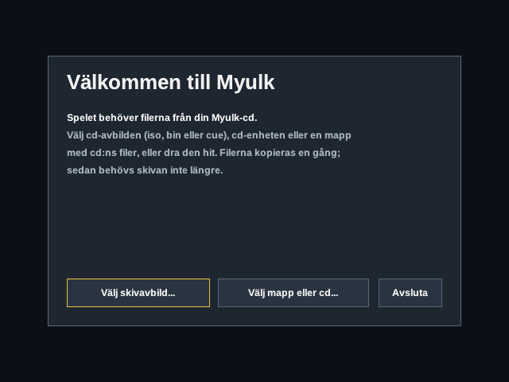
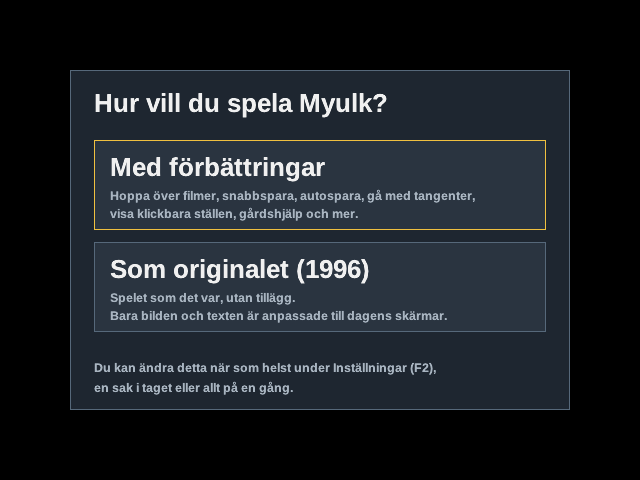
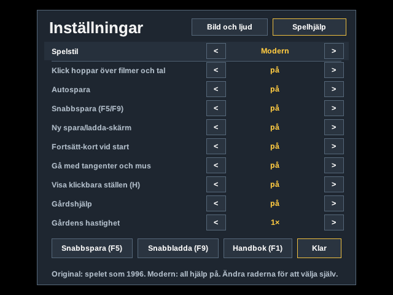

# Myulk – Kampen om det öppna landskapet, recompiled

[](LICENSE)


*Myulk* (1996) is a Swedish adventure and farm game. You inherit the run-down farm Öppanäng, solve puzzles in the adventure parts (Ödegården, Staden, Underjorden) and run a dairy farm for three years in between. It was made with Delphi 1 for Windows 3.1, so it no longer runs on today's computers.

This project brings it back by **static recompilation**: a tool translates the original 16-bit program, `MYULK.EXE`, into C++. A small, newly written Windows 3.1 layer on SDL3 runs that code on Windows today and in the browser. The game you play is the original game, every scene, puzzle and rule, with its own pictures, films and sounds from your CD. On top of that come optional modern conveniences, each of which can be switched off.

**No game files are included.** You need your own copy of the Myulk CD.

Project website (Swedish and English): **https://machosallad.github.io/myulk-recomp/**

| First start: choose your CD | How do you want to play? | Every helper can be switched off |
|---|---|---|
|  |  |  |

## What you get

- **The whole game.** The intro, all three adventure chapters, the farm years, the ending.
- **Desktop and browser.** A Windows program, and a WebAssembly build for Chrome and Edge, including phones and tablets (touch).
- **Play it as in 1996, or modern.** The first start asks how you want to play. Every helper has its own switch in the settings (F2 › Spelhjälp):
  - a click skips the film or line being played
  - quick-save and quick-load (F5/F9), autosave
  - a modern save and load screen with pictures, names and dates
  - "Fortsätt" at start: continue your latest save in a few seconds
  - arrow keys, right-click and the mouse wheel to move around
  - hold H to see everything you can click in a scene
  - farm helper: pause (P), next day with a click on the day clock (or N), notes about money and seasons; farm speed 1×–8×
- **The handbook** (F1, or the game's own Handbok button). The original help file, with its glossary of farming words and hints for every part of the adventure, in a modern viewer with search.
- **For today's screens.** Sharp or smooth scaling, pure integer scaling, an optional filter that smooths the art's 256-colour dither, crisp or smooth TrueType text, fullscreen, a window that remembers its place, separate music and speech volumes, F12 screenshots.
- **Saves stay compatible.** They use the original `.MLK` format, written by the game's own code.

## Playing

**With a built program**, all you need is your CD. On the first start the game asks for it: choose the CD image (`.iso`, or `.bin`/`.cue`), the CD drive or a folder with the CD's files, or drop it on the window. It checks that it's the right edition and copies the game's files once, in a few seconds; from then on it starts straight away. The browser version works the same way: the page asks for the CD image, reads it in the browser and keeps the files there. Nothing is uploaded.

**Building it** from this source code needs your CD as well, since the recompiler translates your `MYULK.EXE`. On Windows:

```bat
powershell -ExecutionPolicy Bypass -File tools\setup-windows.ps1
"C:\Program Files\7-Zip\7z.exe" x -y -oextracted\iso C:\path\to\Myulk.iso
tools\build-native.bat
```

Then start `build\native\myulk_recomp.exe`, or make a program folder with `python tools\package.py desktop`. **[docs/playing.md](docs/playing.md)** explains each step, packages, the browser version, the keys and where saves go.

## How it works

```
your CD ─► MYULK.EXE ─► tools/recomp (Python + capstone) ─► C++ (one function per routine)
                                                              │
         src/recomp/runtime   emulated CPU state, segmented memory, x87, the EXE's data
         src/recomp/win16     KERNEL, USER, GDI, MMSYSTEM on SDL3: windows, controls,
                              fonts, Cinepak films, sound, files
         src/recomp/enhance   the modern extras: settings, saves, handbook, helpers
```

The recompiler finds every routine of the program by following its code from the entry points: 3,926 routines and about 176,000 instructions, none left unsupported. It writes each one as a C++ function that works on a model of the 16-bit CPU. The program's 235 Windows API calls go to a newly written implementation of the parts of Windows 3.1 the game uses. Nothing is emulated instruction by instruction at run time, and none of the game logic is rewritten by hand. **[docs/recompiler.md](docs/recompiler.md)** describes the whole pipeline.

## Status

- The whole game plays from the intro to the ending: all three adventure chapters and the three farm years, including saving and loading.
- Tested on Windows 11, and in current Chrome and Edge on the desktop. Touch was tested with an emulated phone, not yet on real devices.
- Linux and macOS should build with the same CMake presets (SDL3 and portable C++20), but haven't been tried yet.
- The browser version needs WebAssembly JSPI, which Firefox and Safari don't enable yet, so it doesn't run on iPhones and iPads.
- One edition of the CD is known. A program built from it accepts only that `MYULK.EXE`; another edition would need its own build.

Found a problem? Please open an issue with what you did, what happened, and whether it was the desktop or the browser version. A save file (`.MLK`) from just before helps a lot.

## Repository

| Folder | Contents |
|---|---|
| `tools/recomp/` | the static recompiler (`recomp.py`), extra entry points, routine hooks |
| `src/recomp/` | runtime, Windows 3.1 layer, modern extras, entry point |
| `web/` | the page for the browser build |
| `tools/` | setup, build and packaging scripts, data tools, analysis helpers |
| `docs/` | documentation (below) |
| `analysis/` | notes and tables from studying the original program |
| `src/` (other folders), `tests/` | an earlier hand-written port of the first scenes, kept for reference (`myulk` target) |

Not in the repository, and ignored by git: `iso/` and `extracted/` (your CD), `build/` (including the generated C++), `decomp/` and `ghidra_project/` (analysis of the original program).

## Documentation

- [docs/playing.md](docs/playing.md): setting up, building, playing, keys, saves, the browser
- [docs/recompiler.md](docs/recompiler.md): how the recompilation works
- [docs/building.md](docs/building.md): building in detail, every feature and setting, test automation
- [docs/game-outline.md](docs/game-outline.md): how the game works: screens, calendar, save format, adventure engine
- [docs/code-map.md](docs/code-map.md): classes, event handlers and layout of the original program
- [docs/extraction.md](docs/extraction.md): what the original game is made of, and extracting its resources
- [docs/third-party.md](docs/third-party.md): libraries, fonts and references used

## Contributing

Contributions are welcome; see [CONTRIBUTING.md](CONTRIBUTING.md). The one firm rule: nothing from the game (files, screenshots of it, text from it, or code generated from it) goes into the repository.

## Legal

*Myulk* and its contents belong to their rights holders. This repository contains only code written for this project: no game files, no code from the original program and no generated code.

A built program contains **code translated from `MYULK.EXE`** (the game's logic), but none of the CD's files: the pictures, films, sounds, text and data are read from each player's own copy, and the program only runs with the edition of the game it was made from. A package made with `--game` also contains the CD's files and is meant for your own use. The game belongs to its rights holders; think about that before passing built programs on.

The project's own code is under the [MIT licence](LICENSE); the third-party parts are listed in [docs/third-party.md](docs/third-party.md).
